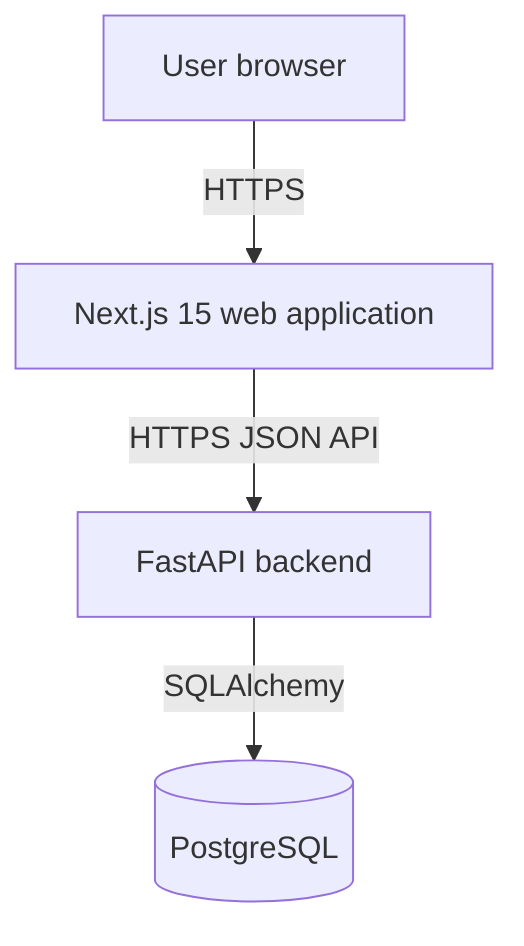

# CloudBench Architecture

## Status

**Status:** Planned foundation. No application services have been implemented or deployed yet.

## System overview

CloudBench is planned as a small, provider-portable full-stack application for recording service checks and incidents.



The application boundary is intentionally small:

- The web application presents the service list, service details, event history, and forms.
- The API owns validation, domain rules, persistence, and the HTTP contract.
- PostgreSQL stores services and service events.
- Deployment-specific concerns remain outside the core application.

## Frontend

The frontend will use Next.js 15 App Router, React 19, and TypeScript.

Server Components will be preferred for initial page rendering and read-oriented content. Client Components will be limited to forms, interactive actions, toast notifications, and animations that improve feedback.

The planned UI will use Tailwind CSS v4, shadcn/ui, Radix UI Primitives, Framer Motion, and Sonner. These are planned dependencies, not yet implemented features.

## Backend

The backend will use Python and FastAPI.

The intended request flow is:

```text
HTTP route
  -> Pydantic request/response schema
  -> application/domain service
  -> repository/data-access layer
  -> SQLAlchemy session
  -> PostgreSQL
```

Business rules will not be placed directly in route handlers. The backend will expose a versioned API and FastAPI-generated OpenAPI documentation.

## Database

PostgreSQL will be the persistent database for all environments that need relational persistence.

The first domain model is expected to contain:

- `services`
- `service_events`

Schema evolution will use migrations rather than manual production changes. The final schema and indexes will be designed when the database milestone begins.

## Communication

The browser will communicate with the web application over HTTPS. The web application will communicate with the FastAPI API using JSON over HTTPS. The API will communicate with PostgreSQL through a configured database connection.

The application will not depend on a vendor-specific SDK for core domain behavior. Provider integrations, deployment configuration, and monitoring adapters must remain isolated.

## Local development architecture

Local development must be possible with free software:

```text
Local browser
    |
    v
Next.js development server
    |
    v
FastAPI development server
    |
    v
Local PostgreSQL process or Docker PostgreSQL container
```

The database URL and other justified configuration values will be supplied through environment variables. A hosted database is not required for local development.

## Future deployment architecture

The target deployment shape is provider-agnostic:

```text
Public HTTPS
    |
    +--> Next.js frontend
    |
    +--> FastAPI backend
              |
              +--> PostgreSQL
```

The final hosting provider will be selected later after verifying current free-tier rules, persistence, sleep behavior, quotas, HTTPS, logs, secrets, and billing risk. Azure is optional; Azure for Students verification is not currently confirmed, and no Azure resources will be provisioned during Milestone 0.

## Why a modular monolith

CloudBench starts as a modular monolith because it provides clear internal boundaries without the operational cost of multiple services.

This approach gives the project:

- simpler local development;
- one backend deployment unit;
- straightforward database transactions;
- easier integration testing;
- lower free-tier resource usage;
- fewer network and deployment failure modes; and
- a clear path to extract a service only if a later requirement justifies it.

Microservices would introduce service contracts, deployment coordination, network failures, duplicated configuration, and more complex observability before the product has a need for them.

## Deliberately excluded infrastructure

### Redis

There is no current caching, distributed session, or rate-limiting requirement that justifies Redis. PostgreSQL and application-level logic are sufficient for the MVP.

### Queues, Kafka, and RabbitMQ

The MVP has no long-running asynchronous workflow, notification pipeline, or ingestion volume that requires a message broker. Synchronous API transactions are easier to test and operate.

### Kubernetes

The project has no scale or orchestration requirement that justifies Kubernetes. A simple free-tier application host is more appropriate for a zero-budget portfolio project.

### Cloud-specific core logic

Azure, or any future provider, must not become a requirement for running the application locally. Infrastructure-specific configuration belongs under deployment documentation or isolated infrastructure files.

## Architectural guardrails

- Add a technology only when a concrete requirement needs it.
- Prefer free and open-source tools.
- Keep core application behavior portable between providers.
- Treat environment configuration as external input.
- Do not claim a planned component is implemented.
- Verify each meaningful milestone with automated checks once code exists.
